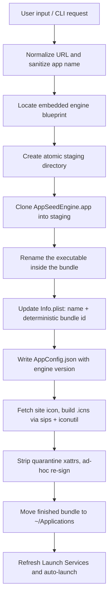

# AppSeed

Turn any web app into a native macOS `.app`, in under a second, from a
system-wide hotkey. Every generated app is a real bundle in `~/Applications`
with its own icon, its own siloed login session, and no browser chrome.

The sites you live in all day deserve better than a tab. Press `⌥P`, type a
URL, hit Enter: AppSeed clones a pre-compiled engine bundle, customizes it
for that site, signs it, and installs it. The result looks and behaves like a
native app - separate cookies and Keychain per site, native notifications,
real windows - and regenerating it never logs you out.

## Quickstart

**You need:** macOS 13.0+, Apple Silicon, and the Xcode Command Line Tools
(`xcode-select --install`).

```bash
git clone https://github.com/Samiu1/AppSeed.git && cd AppSeed

# Build AppSeedEngine.app + AppSeed.app (output lands in build/)
./Scripts/build.sh

# Launch the background agent (no Dock icon; look for the leaf in the menu bar)
open build/AppSeed.app
```

Press **`⌥P`**, type or paste a URL (`linear.app`, `notion.so`), hit
**`Enter`**. The generated app is created in `~/Applications` and launched.

Headless mode for scripting and CI, no HUD required:

```bash
./build/AppSeed.app/Contents/MacOS/AppSeed --make https://excalidraw.com --name "Excali" --overwrite
```

## What AppSeed can do

| Feature | Status | What it does |
|---------|--------|--------------|
| URL to native app | Live | Clones the engine blueprint, customizes, ad-hoc signs, and installs in under a second |
| Global hotkey (`⌥P`) | Live | Carbon `RegisterEventHotKey`, so it fires while AppSeed is unfocused; customizable via `defaults write` |
| Siloed sessions | Live | Deterministic bundle id per domain keeps each app's cookies, cache, and Keychain separate - and alive across regeneration |
| Automatic icons | Live | Scrapes the site's touch icon and builds a multi-resolution `.icns` with `sips` + `iconutil`; falls back to the AppSeed leaf |
| Title suggestion | Live | Fetches the page `<title>` in the background; falls back to the domain name instantly |
| Third-party OAuth | Live, validated on-device | Google/Microsoft/Apple sign-in stays inside the app's WebView so `state` and cookies never split across contexts |
| Native notifications | Live | The web `Notification` API is bridged to `UNUserNotificationCenter`, with real permission state and click-through |
| Popups, downloads, camera/mic | Live | `window.open` gets a real window sharing the session store; downloads land in `~/Downloads`; capture requests get native prompts |
| Custom CSS/JS injection | Live | Per-app `inject.js` / `custom.css` in `~/Library/Application Support/AppSeed/<bundle id>/` |
| My Apps + favorites | Live | Settings window lists every generated app; favorites pin to the menu bar; Remove trashes the app and its data |
| Update All Apps | Live | Regenerates apps built on an older engine version, logins intact |
| Start at Login | Live | Modern `SMAppService` login item, visible in System Settings |
| Headless CLI | Live | `AppSeed --make <url>` for automation and end-to-end testing |
| Background push (service workers) | Not built | Foreground `Notification` API only; no push service or VAPID keys |

## How it works

Two Swift binaries, built with plain `swiftc` (no Xcode project, no
dependencies):

- **AppSeed** - the factory. A background agent (`LSUIElement`, no Dock
  icon) with a menu bar item, a Spotlight-style HUD, and the cloning
  pipeline.
- **AppSeedEngine** - the runtime blueprint. A hidden-title-bar window
  filled edge-to-edge with `WKWebView`. Compiled once, embedded in the
  factory, and cloned per generated app.



Everything happens in a temp directory; only a finished, signed bundle ever
reaches `~/Applications`. Full details in
[docs/ARCHITECTURE.md](docs/ARCHITECTURE.md).

## Quality: invariants, CI, and on-device validation

AppSeed has no unit-test suite. Verification is three layers, each aimed at
the failures that actually hurt:

1. **CI build on every push and PR** (macos-15): compiles both bundles,
   verifies both code signatures, and checks the engine is embedded.
2. **End-to-end smoke test in CI**: runs the real `--make` pipeline and
   asserts the two invariants that keep the product trustworthy - the
   generated bundle id is the deterministic
   `com.appseed.wrapped.example-com` (logins survive regeneration), and the
   quarantine attribute is gone (Gatekeeper does not kill the app).
3. **On-device validation**: Google OAuth sign-in and persistence verified
   on a real wrapped site. A broader pass over Notion, Figma, Slack, and
   WhatsApp Web is still open - tracked in [ROADMAP.md](ROADMAP.md).

Suite inventory and how to run it: [docs/EVALUATIONS.md](docs/EVALUATIONS.md).

## Product decisions and their tradeoffs

The short version; each decision has context and a revisit trigger in
[docs/DECISIONS.md](docs/DECISIONS.md):

| Decision | Tradeoff accepted |
|----------|-------------------|
| Clone a pre-compiled engine blueprint | Generated apps freeze on the engine that built them; "Update All Apps" is the fix |
| Deterministic bundle id per domain, never a UUID | One app per domain; no second isolated copy of the same site |
| Zero dependencies, system tools only | Hand-maintained public-suffix list; regex title parsing |
| Apple Silicon only | Intel Macs are unsupported |
| OAuth kept in the app's WebView | Embedded-webview OAuth depends on the desktop-Safari user agent clearing provider blocks |
| Atomic staging + foreign-bundle guard | An overwrite of a non-AppSeed app is downgraded to auto-rename |
| `~/Applications` as the default install location | Per-user install only; no system-wide `/Applications` default |

## Deliberately not built

Background service-worker push, Intel/universal binaries, an Xcode project,
third-party dependencies, notarization and Developer ID signing (deferred
until a paid Apple Developer account), an in-app updater for AppSeed itself,
and a live config channel for already-generated apps. Reasoning and
sequencing live in [ROADMAP.md](ROADMAP.md), including the security
hardening list (S1-S8) that gates distribution.

## Docs

- [ROADMAP.md](ROADMAP.md) - status snapshot, shipped vs outstanding, security list
- [docs/ARCHITECTURE.md](docs/ARCHITECTURE.md) - factory/engine model, generation pipeline, navigation policy
- [docs/EVALUATIONS.md](docs/EVALUATIONS.md) - verification layers, CI inventory, validation status
- [docs/DECISIONS.md](docs/DECISIONS.md) - decision log with tradeoffs and revisit triggers
- [CONTRIBUTING.md](CONTRIBUTING.md) - build, conventions, and the do-not-break invariants

## Commands

| Command | Description |
|---------|-------------|
| `./Scripts/build.sh` | Build both bundles into `build/` (arm64) |
| `open build/AppSeed.app` | Launch the menu bar agent |
| `AppSeed --make <url> [--name N] [--out DIR] [--overwrite]` | Headless app generation |
| `defaults write com.appseed.factory hotkeyKeyCode -int <code>` | Change the hotkey key (default: `P`) |
| `defaults write com.appseed.factory hotkeyModifiers -int <mask>` | Change the hotkey modifiers (Option=2048, Command=256, Control=4096, Shift=512) |

## Advanced configuration

### Injecting CSS and JS

Each generated app gets a customization folder at
`~/Library/Application Support/AppSeed/<bundle id>/`, created on first
launch with commented `inject.js` and `custom.css` templates. Edit those
files and relaunch the app; they apply to every page. The folder survives
regenerating the app because the bundle id is deterministic per domain.

### Troubleshooting

**"Global shortcut unavailable"**: another app has registered the hotkey, or
Carbon failed to initialize. Change the shortcut with the `defaults write`
commands above, or open the app directly from the menu bar item.

**"App is damaged and can't be opened"**: the generated bundle kept its
quarantine attribute. The factory's strip-and-sign step prevents this; to
fix an affected app manually, run
`xattr -d com.apple.quarantine "/path/to/YourApp.app"`.

**Google sign-in shows `disallowed_useragent`**: AppSeed's engine presents a
desktop-Safari user agent and keeps the whole OAuth flow inside the app's
WebView, which clears this for the providers in `authProviders`
(Google, Microsoft, Apple). If a site uses a different identity provider
that blocks embedded views, that provider needs to be added to the list in
`NavigationCoordinator.swift`.
