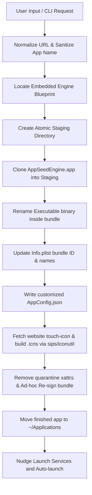

# AppSeed

AppSeed is a lightweight macOS utility that converts web applications into standalone, native macOS `.app` bundles in under a second. It runs as an invisible agent in the background, summoned instantly via a system-wide hotkey to turn any URL into a native macOS app.

By wrapping sites in a highly optimized `WKWebView` container with custom configuration, AppSeed provides features like separate cookie/login storage per app, global hotkey summoning, custom scripting/styling injection, and seamless OAuth flow redirection.

---

## Table of Contents

1. [Key Features](#key-features)
2. [Tech Stack](#tech-stack)
3. [Prerequisites](#prerequisites)
4. [Getting Started](#getting-started)
   - [Building from Source](#building-from-source)
   - [Running the App](#running-the-app)
5. [Architecture &amp; System Design](#architecture--system-design)
   - [Directory Structure](#directory-structure)
   - [App Generation Pipeline](#app-generation-pipeline)
   - [Key Components](#key-components)
6. [CLI &amp; Headless Usage](#cli--headless-usage)
7. [Advanced Configuration](#advanced-configuration)
   - [Custom Global Hotkey](#custom-global-hotkey)
   - [Injecting CSS &amp; JS](#injecting-css--js)
8. [Troubleshooting](#troubleshooting)

---

## Key Features

- **Summon via Hotkey**: Summons a floating Spotlight-like input card anywhere on your desktop via `⌥P` (Option + P).
- **Sub-Second Generation**: Clones and builds a customized target application bundle atomically in under a second.
- **Siloed Storage & Sessions**: Assigns each generated app a deterministic bundle identifier, keeping cookies, cache, and Keychain credentials siloed per site.
- **Automatic Icon Building**: Downloads the website's best touch-icon or PNG and converts it to a native macOS `.icns` file using `sips` and `iconutil`.
- **Title Fetching**: Queries the website's `<title>` in the background to automatically suggest a clean app name.
- **OAuth Safety**: Intercepts known identity providers (Google, Microsoft, Apple, etc.) that block embedded web views and routes them through a secure, cookie-sharing `ASWebAuthenticationSession`.
- **Script & Style Injection**: Allows tailoring wrapped sites (e.g., hiding sidebars/headers) by injecting custom CSS (`custom.css`) or JS (`inject.js`) on launch.
- **Headless CLI**: Includes a hidden command-line interface (`AppSeed --make <url> ...`) for headless automation and testing.

---

## Tech Stack

- **Language**: Swift 5.10+ (compiled with `swiftc`)
- **UI Framework**: AppKit (native macOS HUD and popups)
- **Web Engine**: WebKit (`WKWebView`)
- **System APIs**: Carbon (for the system-wide global hotkey), AuthenticationServices (`ASWebAuthenticationSession`)
- **System Tools**: `sips` (image formatting), `iconutil` (assembling `.icns` packages), `codesign` (re-signing modified binaries), and `xattr` (removing Gatekeeper quarantine attributes)
- **Target Architecture**: Apple Silicon (`arm64-apple-macos13.0`+)

---

## Prerequisites

- **macOS 13.0 (Ventura)** or higher.
- **Apple Silicon** (M1/M2/M3/M4) Mac.
- **Xcode Command Line Tools** installed (provides `swiftc`, `codesign`, `sips`, `iconutil`, and `xattr`).
- **Accessibility Permissions** (optional but highly recommended): Prompted on first launch to allow Carbon to intercept the global hotkey when AppSeed is out of focus.

---

## Getting Started

### Building from Source

To compile AppSeed and its blueprint engine, run the provided build script from the repository root:

```bash
./Scripts/build.sh
```

This script:

1. Compiles the `AppSeedEngine` runtime blueprint and signs it.
2. Compiles the main `AppSeed` factory application.
3. Embeds `AppSeedEngine.app` into the resources of `AppSeed.app` so it can clone it at runtime.
4. Generates both finished binaries under the `build/` folder.

### Running the App

1. Double-click `build/AppSeed.app` to launch the background agent.
2. Grant Accessibility permissions if prompted (necessary for the global hotkey to work while you are focused in another application).
3. Press **`⌥P`** (Option + P) to display the HUD input card.
4. Type or paste a URL (e.g., `linear.app` or `notion.so`) and hit **`Enter`**.
5. The generated app is instantly created in `~/Applications` and automatically launched.

---

## Architecture & System Design

### Directory Structure

```
AppSeed/
├── AppSeed/                  # The factory application
│   ├── App/                  # App delegate, permissions check, and hotkey management
│   ├── Factory/              # Staging pipeline, CLI mode, icon/title fetching
│   ├── Resources/            # Info.plist and default assets
│   └── Views/                # HUD window (Spotlight card) manual layouts
├── AppSeedEngine/            # The runtime engine blueprint (cloned by the factory)
│   ├── Core/                 # Main delegate, browser controller, navigation logic
│   ├── Inject/               # custom.css and inject.js injection system
│   └── Resources/            # Default AppConfig.json template and Info.plist
├── Shared/                   # Common structures (AppConfig, DomainUtils)
├── Scripts/                  # build.sh and default icon builder script
└── build/                    # Output directory for compiled applications
```

### App Generation Pipeline

When you submit a URL in the HUD or via the CLI, the following pipeline executes:



### Key Components

- **[AppFactory](<file:///Users/samiulislam/Documents/Samiul%20Personal/AppSeed/AppSeed/Factory/AppFactory.swift>)**: Performs the atomic cloning pipeline. Every mutation happens in a temporary directory, ensuring a half-built bundle never reaches the destination.
- **[HotkeyManager](<file:///Users/samiulislam/Documents/Samiul%20Personal/AppSeed/AppSeed/App/HotkeyManager.swift>)**: Implements system-wide Carbon event handlers. Since Carbon works when the application is an out-of-focus background agent (`LSUIElement`), it is used instead of AppKit/SwiftUI keyboard monitors.
- **[NavigationCoordinator](<file:///Users/samiulislam/Documents/Samiul%20Personal/AppSeed/AppSeedEngine/Core/NavigationCoordinator.swift>)**: Restricts the main window to same-site navigation. Genuine user-initiated cross-site clicks hand off to the default browser. Popup requests (`window.open`) are opened in separate native windows sharing the cookie/session store.
- **[IconBuilder](<file:///Users/samiulislam/Documents/Samiul%20Personal/AppSeed/AppSeed/Factory/IconBuilder.swift>)**: Scrapes the site's touch-icons or HTML `<link rel="icon">` tags, downloads the image, and utilizes `sips` + `iconutil` to produce the multi-resolution `.icns` package.
- **[ResourceInjector](<file:///Users/samiulislam/Documents/Samiul%20Personal/AppSeed/AppSeedEngine/Inject/ResourceInjector.swift>)**: Scans the app bundle's resources at runtime. If `inject.js` or `custom.css` are found, it injects them via `WKUserContentController` at document end.

---

## CLI & Headless Usage

AppSeed contains a headless command-line mode for scripting or automated testing. When invoked with the `--make` argument, the process compiles the app without opening the HUD:

```bash
./build/AppSeed.app/Contents/MacOS/AppSeed --make <url> [--name <name>] [--out <directory>] [--overwrite]
```

### Arguments

| Flag              | Description                                                    | Default                                                 |
| ----------------- | -------------------------------------------------------------- | ------------------------------------------------------- |
| `--make <url>`  | The URL of the web application to package.                     | *(Required)*                                          |
| `--name <name>` | Custom name for the generated`.app`.                         | First label of the registrable domain (e.g.,`Linear`) |
| `--out <dir>`   | Destination directory to install the app bundle.               | `~/Applications`                                      |
| `--overwrite`   | Overwrites any existing application bundle with the same name. | Auto-renames by appending a number (e.g.,`App 2.app`) |

### Example

```bash
# Packages Excalidraw, customizes its name, and overwrites any existing copy
./build/AppSeed.app/Contents/MacOS/AppSeed --make https://excalidraw.com --name "Excali" --overwrite
```

---

## Advanced Configuration

### Custom Global Hotkey

You can customize the shortcut used to summon AppSeed by writing Carbon virtual key codes and modifier masks to the defaults database:

```bash
defaults write com.appseed.factory hotkeyKeyCode -int <virtual-key-code>
defaults write com.appseed.factory hotkeyModifiers -int <carbon-modifier-mask>
```

#### Modifier Key Mask Reference

- **Option Key**: `2048`
- **Command Key**: `256`
- **Control Key**: `4096`
- **Shift Key**: `512`

*Example (changing hotkey to `⌥⌘S`):*

```bash
# 1 = Key 'S' virtual key code
defaults write com.appseed.factory hotkeyKeyCode -int 1
# 2048 (Option) + 256 (Command) = 2304
defaults write com.appseed.factory hotkeyModifiers -int 2304
```

### Injecting CSS & JS

To customize the styling or behavior of a generated app:

1. Locate your generated app in `~/Applications` (e.g. `Linear.app`).
2. Right-click and choose **Show Package Contents**.
3. Navigate to `Contents/Resources/`.
4. Create an `inject.js` and/or `custom.css` file.
5. Add your custom styling/javascript. The next time the app opens, these modifications will be automatically applied.

---

## Troubleshooting

### "Global shortcut unavailable"

This alert indicates another application has already registered the shortcut (default `⌥P`), or Carbon failed to initialize the keyboard hooks. You can:

1. Clear conflicts in other apps or system settings.
2. Change the AppSeed hotkey using the `defaults write` commands listed in [Custom Global Hotkey](#custom-global-hotkey).
3. Open the app by double-clicking it directly in Finder.

### "App is damaged and can't be opened"

If Gatekeeper throws this warning on launching a generated app, it is because macOS detected the `com.apple.quarantine` attribute on a newly created and ad-hoc signed app bundle.

- **Solution**: The factory's [stripQuarantineAndSign](<file:///Users/samiulislam/Documents/Samiul%20Personal/AppSeed/AppSeed/Factory/AppFactory.swift#L185-L199>) step handles this. Ensure AppSeed has permissions to run shell processes, or manually clear it via:
  ```bash
  xattr -d com.apple.quarantine "/path/to/YourApp.app"
  ```

### Google Sign-in 403 (disallowed_useragent)

Google blocks OAuth logins inside embedded web views (`WKWebView`).

- **Solution**: AppSeed's `NavigationCoordinator` automatically intercepts routing to `accounts.google.com` and executes it in `ASWebAuthenticationSession`. If a redirect fails to trigger, ensure the site's identity provider utilizes one of the domains listed in the `authDomains` constant.
